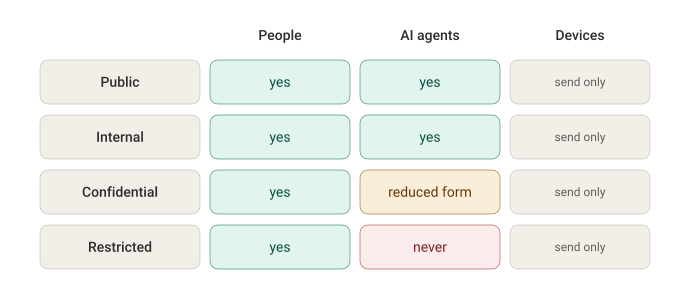
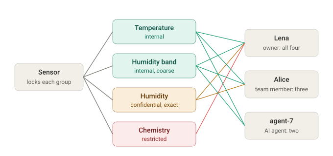
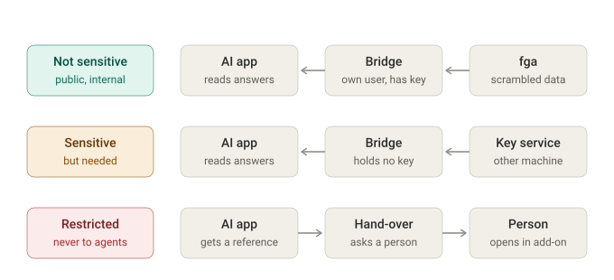

# Agents and sensitive data

Status: proposal for the owner's OK, 5 November 2026. Nothing is built.

It follows the owner's direction of 5 November 2026: all data is end-to-end encrypted, the servers never work on content, and fga sees only names and structure, including the field names of JSON readings.

It sits with the console plans for now. The fga parts (rules, sentinels, the bridge) belong in fga's `docs/design` once they are built.

## The problem

When everything is end-to-end encrypted, AI agents decrypt on their own computer, through `fga mcp-bridge`. That computer also runs software that is easy to trick: an agent with shell access, misled by a malicious document, could copy the key it uses. A stolen key works offline, isn't logged, and can't be taken back for data already fetched.

Perfect key protection on every agent's computer isn't realistic. So the approach is the reverse: **agents never hold a key to anything whose leak would hurt.** A leaked agent key then exposes, at most, what was already accepted for that agent.

## 1. Who may ever hold a key copy

Every file, document section and reading group carries a sensitivity level. fga already has four: public, internal, confidential, restricted. Who may ever receive a key copy is decided once, per level and per kind of consumer:

- **People:** every level, as the rules allow.
- **AI agents:**
  - public and internal: yes;
  - confidential: only a reduced form (section 2);
  - restricted: never, only a reference (section 3).
- **Devices:** send only; they never read back.

fga enforces this with its rules, as it enforces everything else. Agents are told apart from people by their role (`AI agent` in the console). A key copy is only made for a key that may `receive-key` (the existing checks at finalize and on sharing), so a rule saying "an agent's key never receives restricted data" covers every route.

## 2. Reduced forms come from the source

The servers never work on content, so a reduced form can't be made on a server. It's made where the data is created: the device sends a coarse field as its own field group, at a lower level, next to the exact value. Each group is locked separately, only for the readers of its level:

In the example:
- the sensor sends temperature (internal), a humidity band of "high" or "normal" (internal), the exact humidity (confidential) and soil chemistry (restricted);
- the owner, Lena, receives all four;
- Alice, a team member, receives three;
- the agent receives only the two internal groups.

This already fits fga:
- a source's record defines its field groups and their levels;
- client-mode readings lock each group for exactly the readers that group's source version names (D-K);
- a data tool shows only chosen groups, and the bridge builds its answer.

For files and documents, a reduced form (a summary, an extract) is made by a person or trusted program on the client, as an output made from a file. It's recorded with a signed note of what it was made from.

## 3. References for restricted data

An agent may know that a restricted item exists, its name and who owns it, but never its content. If its task needs the content, it hands over to a person: "ask Lena to check clause 4 of contract-draft.pdf". The person opens it in the add-on.

## 4. Key protection follows what a key opens

1. **Every agent.**
   - The agent has its own key, never a person's.
   - Access is given by key copies for that key, which a person makes in the add-on, so giving an agent access is an explicit act.
   - The bridge runs as its own user, or in its own container. The agent talks to it only through its input and output, so it can't read the bridge's key folder or memory.
   - Short passes, fetched and renewed by the bridge, instead of long-lived passes in environment variables.
2. **Agents that read sensitive data they need.** The bridge holds no key. It sends each locked key copy to a key service on another machine, which opens just that file key. The service enforces limits (amount per hour, a person's approval for some groups) and keeps its own log. The agent's computer never sees the agent's private key.
3. **Restricted data.** No agent key opens it, so there's nothing to protect on the agent's side.
4. **Later:** the key in hardware that never hands it out. Most built-in secure chips don't support the X25519 curve fga uses, so suitable hardware has to be confirmed first.

What no key protection stops: an agent misled into misusing what it may read. fga's MCP rules limit where data can be sent. Everything an agent reads still goes to its AI model.

## 5. A check when rules are signed

A mistake in the rules, such as a restricted group locked for an agent, should be caught before the rules go live. fga's signed rule releases already carry sentinels: known requests with the answer they must get. Every sentinel must hold before a release can go live (REL-004, `internal/release`).

Sentinels such as "an AI agent's key may not receive a key copy of a restricted unit" turn the table in section 1 into checks that stop a faulty release, with no new fga code. A sentinel tests the cases it names, not every possible one, so the set should cover each kind of agent and each kind of restricted data the organisation has.

## Decisions for the owner

- **G-1. The table in section 1.** Who may ever receive which level: as proposed, or different per team.
- **G-2. Reduced forms.** Made at the source, as extra field groups, or by a person or trusted program on the client. Never by a server.
- **G-3. References for restricted data.** Agents see that restricted items exist and who owns them, but never their content.
- **G-4. Agent keys.**
  - Each agent has its own key, receiving key copies only by a person's act.
  - The bridge is isolated from the agent.
  - Short passes are fetched by the bridge.
  - To confirm in the demo: that today's rules let an agent's own key receive key copies under its delegation.
- **G-5. The key service.** Protection level 2 above. It would be new software in its own repository, outside fga's servers, built only if agents need sensitive data.
- **G-6. Sentinels.** Sentinels that enforce the table go into every signed rule release.
